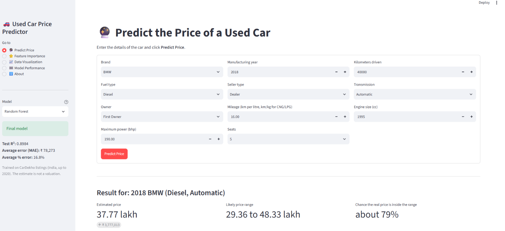
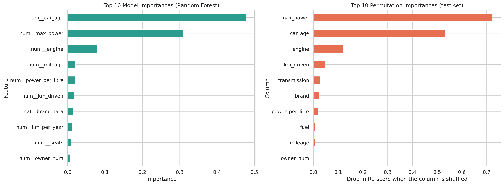

# Used Car Price Prediction System

**Devixo Solutions | AI/ML Internship Program | Task 04: End-to-End ML Application with Deployment**

**Author:** Aman Hameed Ullah
**Internship Domain:** AI/ML

## Project Objective

To build a complete machine learning application that takes real-world user input, generates a prediction and presents it through an interactive interface. The application estimates the **selling price of a used car** (in Indian rupees) from its details, together with a likely price range.

## Live Application

[your-streamlit-link]

## Dataset Description

The CarDekho used-car dataset contains 8,128 listings with 13 columns: name, year, selling price, kilometers driven, fuel, seller type, transmission, owner, mileage, engine, maximum power, torque and seats. After cleaning (1,202 duplicates, 5 test-drive cars and 3 cars with more than 500,000 km removed) 6,918 cars remained.

## Dataset Source

Kaggle: [Vehicle Dataset from CarDekho](https://www.kaggle.com/datasets/nehalbirla/vehicle-dataset-from-cardekho) by Nehal Birla (file `Car details v3.csv`).

## Technologies Used

Python 3, Google Colab, Streamlit, Plotly, GitHub

## Libraries Used

Pandas, NumPy, Matplotlib, Seaborn, Scikit-learn, XGBoost, Plotly, Joblib, Streamlit

## Project Workflow

1. **Data processing:** text columns with units converted to numbers, duplicates and impossible values removed, outliers analyzed with the IQR method (genuine luxury cars kept), 5 features engineered (car age, brand, owner number, kilometers per year, power per litre).
2. **Pipeline:** median imputation, scaling and one-hot encoding in one scikit-learn pipeline, fitted on the training data only. The target is modeled on a log scale and converted back to rupees automatically.
3. **Models:** Linear Regression, Decision Tree, Random Forest, Gradient Boosting and XGBoost, compared with MAE, MSE, RMSE and R².
4. **Tuning:** GridSearchCV and RandomizedSearchCV, with a comparison before and after tuning, plus cross-validation and feature importance.
5. **Saving:** the final model and the other tuned models were saved with Joblib.
6. **Application:** a Streamlit app with five pages, deployed online.

## Results (test set)

| Model                     | R² before | R² after tuning | MAE after (rupees) | MAPE after |
| ------------------------- | --------- | --------------- | ------------------ | ---------- |
| **Random Forest (final)** | 0.8982    | **0.8984**      | 78,273             | 16.80%     |
| XGBoost                   | 0.9118    | 0.8981          | 78,075             | 16.42%     |
| Gradient Boosting         | 0.8954    | 0.8922          | 80,165             | 16.70%     |
| Decision Tree             | 0.8473    | 0.8770          | 90,675             | 19.96%     |
| Linear Regression         | 0.8426    | 0.8426          | 98,548             | 20.42%     |

## Major Findings

- The price was strongly right-skewed (skewness 4.19), so a log transform of the target (skewness 0.22) was used.
- The tuned Random Forest was selected (R² 0.8984, RMSE 155,296 rupees). The top three models are practically equal; tuning improved the Decision Tree most (R² +0.0297) and did not improve XGBoost, whose default settings were already good.
- The most important inputs are the maximum power, the age of the car and the engine size.
- A prediction range (about 22% below to 28% above the estimate) contains the real price for 79.3% of the test cars.

## Application Features

| Page               | Content                                                                                                                                           |
| ------------------ | ------------------------------------------------------------------------------------------------------------------------------------------------- |
| Predict Price      | Form for the car details, **Predict Price** button, estimated price, likely range, comparison with similar cars, and the prediction of all models |
| Data Visualization | Filters and interactive charts of the used-car data                                                                                               |
| Model Performance  | Metrics before and after tuning, actual vs predicted prices, error distribution, cross-validation                                                 |
| Feature Importance | Permutation importance and model importance                                                                                                       |
| About              | Method, data and limitations                                                                                                                      |

The user can also **select the prediction model** (five tuned models).

## Screenshots

| Predict page                  | Feature importance                           |
| ----------------------------- | -------------------------------------------- |
|  |  |

## Project Structure

```
Task_04_AI_ML/
├── dataset/        car_details.csv, cleaned_car_data.csv
├── notebook/       Task_04_Car_Price_Prediction.ipynb
├── models/         car_price_model.joblib (final), other tuned models, model_info.json, result tables
├── app/            app.py (Streamlit application)
├── images/         charts and screenshots
├── requirements.txt
└── README.md
```

## How to Run the Project

1. Clone the repository:
   ```
   git clone https://github.com/Amankhan987/Task_04_AI-ML_Used_Car_Price_Predictor.git
   cd Task_04_AI-ML_Used_Car_Price_Predictor
   ```
2. Install the libraries (the saved models need scikit-learn 1.6.1 and XGBoost 3.4.1):
   ```
   pip install -r requirements.txt
   ```
3. Run the application from the project root folder:
   ```
   streamlit run app/app.py
   ```
4. The notebook `notebook/Task_04_Car_Price_Prediction.ipynb` contains the full analysis. Change the paths in it if you do not use Google Drive.

## Limitations

The data is a snapshot (cars up to 2020) from one Indian website, so prices do not follow today's market. The car's condition and accident history are unknown, and very expensive cars are predicted less reliably.

## Author

**Aman Khan** | AI/ML Intern, Devixo Solutions
